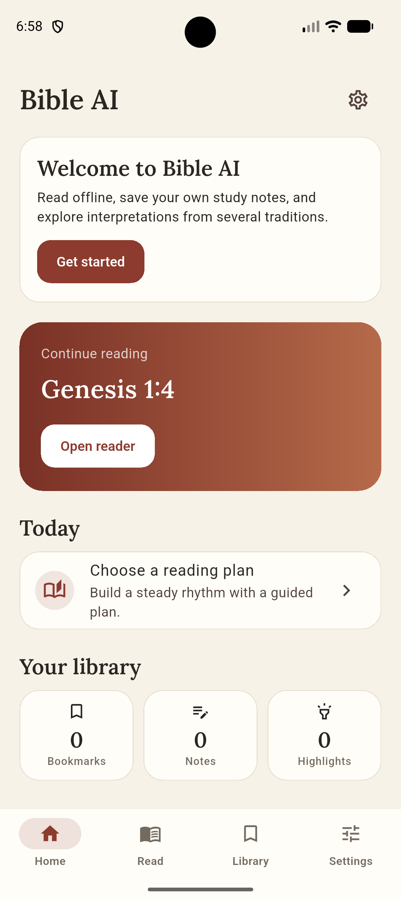
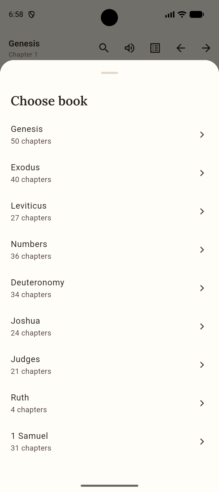
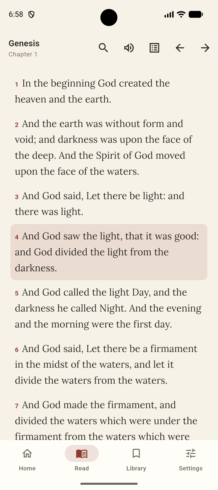
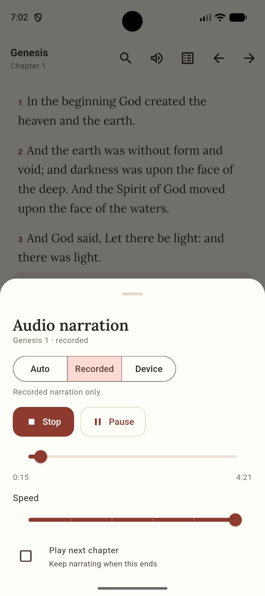

# Bible AI

Bible AI is split into three deliberately separate parts:

1. **Flutter app** — the phone UI and offline Bible reader.
2. **Backend** — the always-on Docker service used by the app.
3. **Python worker** — batch TTS, audio processing, and interpretation jobs.

The backend serves the app continuously. The worker is run manually when you
want to produce audio or interpretation data. TTS and interpretation do not
require Docker.

## Screenshots & Audio Demo

| Home & Dashboard | Book Selection | Scripture Reader | Audio Controls |
|:---:|:---:|:---:|:---:|
|  |  |  |  |

### 🎙️ Narration Samples

Sample batch TTS narrations generated by the background worker:

- 🔊 **Old Testament**: [Genesis 1 (`genesis_chapter_1.mp3`)](docs/audio/genesis_chapter_1.mp3)
- 🔊 **New Testament**: [Matthew 1 (`matthew_chapter_1.mp3`)](docs/audio/matthew_chapter_1.mp3)

## Repository structure

| Directory | Role | Runs continuously? |
|---|---|---|
| `lib/`, `assets/`, `android/`, `windows/` | Flutter phone/desktop app | Yes, on the device |
| `backend/` | FastAPI application and runtime dependencies | Yes, on the server |
| `deploy/` | Docker Compose and Nginx configuration | Yes, on the server |
| `worker/` | TTS and interpretation scripts and dependencies | No, only during jobs |
| `shared/`, `tools/` | Data and helpers shared by backend and worker | N/A |

## 1. Backend server

The backend Docker stack contains:

| Service | Purpose |
|---|---|
| `api` | FastAPI API, synchronization, interpretations, and audio metadata |
| `mongo` | Persistent interpretation and synchronization data |
| `rustfs` | S3-compatible storage for generated MP3 files |
| `nginx` | Public API endpoint and audio streaming |

### Requirements

- Docker with Compose
- A LAN IP or hostname reachable by the phone
- TCP port 80 available for Nginx

### Configure and start

From the repository root:

```bash
cp deploy/.env.example deploy/.env
```

Set a strong storage secret and the address phones will use:

```ini
AUDIO_S3_SECRET_KEY=generate-a-long-random-value
AUDIO_PUBLIC_BASE_URL=http://192.168.1.10
```

The API and Python worker must use the same `MONGO_URI`. If the worker uses
MongoDB Atlas or another shared MongoDB server, leave `MONGO_URI_DOCKER`
unset. For a fully local Docker-only database, set
`MONGO_URI_DOCKER=mongodb://mongo:27017` and run the worker with
`MONGO_URI=mongodb://127.0.0.1:27017`.

Generate a secret with:

```bash
python -c "import secrets; print(secrets.token_urlsafe(48))"
```

Start the backend:

```bash
docker compose -f deploy/docker-compose.yml up -d --build
```

Check it:

```bash
curl http://127.0.0.1/api/health
```

The API documentation is available at `http://127.0.0.1/docs`. MongoDB,
RustFS, and backend data persist in Docker volumes. To update the backend, run
the same `up -d --build` command again.

If something fails:

```bash
docker compose -f deploy/docker-compose.yml logs --tail 100
```

Keep the RustFS console on port 9001 private. For public deployment, put TLS
in front of Nginx and use HTTPS.

## 2. Python worker

The worker is separate from the backend. It is used for work that may take
minutes or hours:

- Generate chapter narration with Kokoro TTS.
- Generate and store interpretation notes through Ollama.
- Run future transcription or media-processing jobs without bloating the API.

The worker uses the same MongoDB and RustFS as the backend. It writes chapter
audio locally while generating and uploads completed files to RustFS, where the
backend and Nginx can serve them.

### Install the Python worker

Install Python dependencies once on the machine that will perform generation.
Install `ffmpeg` separately with your operating system package manager.

```bash
cd worker
python -m venv .venv
.venv/bin/activate
pip install -r requirements.txt
ffmpeg -version
```

The worker reads `deploy/.env` automatically. With the Docker backend running,
the default host values (`127.0.0.1` and port `9000`) let it connect to
MongoDB and RustFS published by Docker.

### Generate TTS with Python

First generate one test chapter:

```bash
python worker/generate_kokoro_audio.py \
  --run --translation en-kjv --books GEN --limit 1 --yes
```

Then generate the complete KJV:

```bash
python worker/generate_kokoro_audio.py \
  --run --translation en-kjv --yes
```

The first run downloads the Kokoro model. Generation resumes automatically,
and completed chapters are not synthesised again. Audio is uploaded to RustFS
and becomes available through:

```text
http://YOUR_SERVER_IP/audio/en-kjv/gen/1.mp3
```

Useful Python worker options:

```bash
# Selected books only.
python worker/generate_kokoro_audio.py \
  --run --translation en-kjv --books GEN,EXO --yes

# Local files only; do not upload to RustFS.
python worker/generate_kokoro_audio.py \
  --run --translation en-kjv --no-upload --yes

# Use CUDA when a CUDA PyTorch build is installed.
python worker/generate_kokoro_audio.py \
  --run --translation en-kjv --device cuda --yes
```

The complete KJV contains 1,189 chapters and can require roughly 2 GB.
Press `Ctrl+C` and rerun the same command to resume.

For an NVIDIA GPU, replace the CPU PyTorch package with a compatible CUDA
wheel in the same worker virtual environment. On Linux:

```bash
python -m pip uninstall -y torch
python -m pip install torch --index-url https://download.pytorch.org/whl/cu126
python -c "import torch; print(torch.__version__, torch.version.cuda, torch.cuda.is_available())"
```

On Windows PowerShell, use the worker interpreter explicitly:

```powershell
worker\venv\Scripts\python.exe -m pip uninstall -y torch
worker\venv\Scripts\python.exe -m pip install torch --index-url https://download.pytorch.org/whl/cu126
worker\venv\Scripts\python.exe -c "import torch; print(torch.__version__, torch.version.cuda, torch.cuda.is_available())"
```

The final value must be `True`. Always pass `--device cuda` when testing GPU
usage; it fails immediately if CUDA is unavailable instead of silently using
the CPU:

```bash
python worker/generate_kokoro_audio.py \
  --run --translation en-kjv --books GEN --limit 1 --device cuda --yes
```

### Interpretations with Ollama

Run Ollama separately, then use the same Python environment:

```bash
# In a separate terminal:
ollama serve
```

In the worker terminal:

```bash
ollama pull qwen3.5:9b
ollama list
python worker/generator.py --status
python worker/generator.py --dry-run --model qwen3.5:9b \
  --perspectives core --hours 1
python worker/generator.py --run --model qwen3.5:9b \
  --perspectives core --hours 10 --yes
```

`qwen3.5:9b` is the recommended starting model for an RTX 3060. It is
substantially lighter than the 27B model while being more capable than the
0.8B model. Use `--limit 1` for a test run. The generator is resumable and
skips chapters and perspectives already stored. If a model omits one
perspective, the worker retries that perspective separately; rerun the same
command to backfill any remaining missing entries.

Set `OLLAMA_URL` or use `--ollama-url` for Ollama on another machine. The
worker writes interpretations to the same MongoDB used by the backend, so they
appear in the app without an API restart. For a smaller/faster test, use
`qwen3.5:0.8b`; for higher quality with substantially more memory and time,
try `qwen3.8:27b`.

Example first run:

```bash
python worker/generator.py --run --model qwen3.5:9b \
  --books gen --limit 1 --perspectives core --hours 1 --yes
```

Research is optional. Normal generation uses only the Bible text and local
model. Add `--research` when you want a few DuckDuckGo result snippets
included as background context; the source URLs are saved with the
interpretation:

```bash
python worker/generator.py --run --model qwen3.5:9b \
  --books gen --limit 1 --perspectives catholic \
  --research --research-results 3 --hours 1 --yes
```

Treat research results as leads, not verified authorities. The model is told
to treat fetched pages as untrusted reference material, and the normal
offline/local mode remains the recommended reproducible workflow.

Interpretation generation is disabled on the backend request path by default:

```ini
BIBLEAI_LIVE_GENERATION=0
```

Set it to `1` only if the always-on API should accept live Ollama jobs.

### Sharing and backing up interpretations

MongoDB storage is portable. Export the interpretation collection:

```bash
mongodump \
  --uri "mongodb://127.0.0.1:27017/bibleai" \
  --collection interpretations \
  --out backups/mongodb
```

Restore it on another server:

```bash
mongorestore \
  --uri "mongodb://127.0.0.1:27017/bibleai" \
  backups/mongodb
```

The worker also records the model name and generation source in each document.
When publishing a dump, include the model name, model version/tag, prompt
version, source translation, generation date, and the relevant model license.
Do not publish `deploy/.env`, MongoDB credentials, or private user sync data.

You may open-source the generated interpretations, but model-generated text is
not automatically public domain. Review the applicable model license and the
law of your jurisdiction before choosing a data license. For a fully open
distribution, use public-domain Bible text such as KJV, prefer a permissive
model such as Qwen under Apache 2.0, and publish the generated dataset under
CC BY 4.0 or CC0 only after legal review. Keep attribution and license files
with the export. Ollama's MIT license covers the Ollama software, not the
models it runs.

### Publishing generated interpretations and audio

Do not commit the generated MongoDB database or the `data/audio/` directory to
the normal source repository. This repository should contain the app, backend,
worker, prompts, configuration examples, and reproducible generation commands.
The generated audio is currently about 2 GB and is better distributed through
object storage, a dataset host, or release assets. GitHub is suitable for the
code and a small interpretation export, but not Git history for thousands of
MP3 files.

The source code is Apache-2.0 licensed in `LICENSE`. Generated interpretation
and audio releases use the separate policy in `DATA_LICENSE.md`; review and
update that policy for each translation, model, voice, and research setup.

The generated KJV narration is published on Hugging Face:

- [Bible AI — KJV audio](https://huggingface.co/datasets/Tomopas/bibleai-audio):
  1,189 chapter MP3s (about 2.1 GB) generated with Kokoro-82M voice
  `af_heart`.

The dataset includes `audio-manifest.sha256` for verifying every file. The
generated audio is not stored in this Git repository; the dataset card source
is kept in `docs/hf-dataset-card.md`.

Export interpretations as a public, portable JSON file:

```bash
mkdir -p exports
mongoexport \
  --uri "$MONGO_URI" \
  --db bibleai \
  --collection interpretations \
  --out exports/interpretations.json \
  --jsonArray
```

Publish `exports/interpretations.json` as a GitHub Release asset or on a
dataset host such as Hugging Face Datasets. Include a `DATA_LICENSE.md` file
stating the chosen data license, source translation, model and exact tag,
prompt version, generation date, and any research-source policy.

For a GitHub release, create a tag on the source commit, then upload the JSON
export as a release asset. Do not commit the export to normal Git history.

For audio, keep the generated MP3 files in RustFS/S3-compatible storage or a
dataset/release host and publish a manifest containing each file's path,
checksum, translation, book, chapter, voice, model, and license metadata. The
app should consume the public manifest or the backend API rather than requiring
the audio files inside the Git repository.

Before publishing, check that the Bible translation, Kokoro model and voice,
Ollama model, research sources, and generated text/audio may be redistributed.
Never publish `deploy/.env`, MongoDB credentials, private sync data, or
unreviewed user content.

### Optional Docker worker

The Docker worker remains available for machines where installing Python,
Kokoro, or ffmpeg is inconvenient. It is not the primary workflow:

```bash
docker compose -f deploy/docker-compose.yml --profile tools run --rm worker \
  --run --translation en-kjv --books GEN --limit 1 --yes
```

## 3. Flutter app

The app works offline for the bundled KJV, search, notes, bookmarks,
highlights, reading plans, and device text-to-speech. It uses the backend for
sync, downloaded translations, saved interpretations, and recorded audio.

### Continuous integration and delivery

GitHub Actions runs on pull requests and pushes to `main`:

- Flutter dependency, analysis, tests, and a debug APK build.
- Python syntax checks.
- Docker Compose configuration validation.
- On `main`, backend and worker images are published to GitHub Container
  Registry as `ghcr.io/<owner>/bibleai-backend` and
  `ghcr.io/<owner>/bibleai-worker`.

The workflow publishes container images but does not deploy to a server
automatically. Configure server deployment separately after choosing a hosting
provider and its secrets.

Install and run:

```bash
flutter pub get
flutter analyze
flutter test
flutter run
```

For building release APKs, app bundles, and configuring automated GitHub Actions release publishing, see the [Android Release Guide](docs/RELEASE.md).

### Test generated interpretations and audio

First verify that the backend can see the generated data:

```bash
curl http://127.0.0.1/api/health
curl "http://127.0.0.1/api/interpretations?book=gen&chapter=1"
curl http://127.0.0.1/api/audio/info/en-kjv/gen/1
```

The interpretation response should contain `chapterOverview` entries with
`content`. The audio response should contain `"available": true`.

In the app, open **Settings → Server** and enter the backend's public Nginx
address, for example:

```text
http://192.168.1.10
```

Use these values depending on where the app runs:

- Android emulator: `http://10.0.2.2:8765`
- Physical phone: `http://YOUR_COMPUTER_LAN_IP` (for example,
  `http://192.168.1.10`)
- Desktop: `http://127.0.0.1:8765`

Tap **Check server** and confirm the cloud icon appears. Open a Bible chapter,
tap a verse, and choose **Study interpretations**. To test narration, open a
chapter and press play; with narration source set to **Auto**, the app uses
generated server audio when available and falls back to device text-to-speech
otherwise.

If audio is unavailable, confirm `AUDIO_PUBLIC_BASE_URL` in `deploy/.env`
matches the URL reachable by the device, then restart the stack:

```bash
docker compose -f deploy/docker-compose.yml up -d --build
```

Do not use `localhost` or `127.0.0.1` on a physical phone; those addresses
refer to the phone itself.

Requirements:

- Flutter 3.44 or newer
- Dart 3.12 or newer

## Configuration

Server-only configuration belongs in `deploy/.env`:

| Variable | Purpose |
|---|---|
| `MONGO_URI` | MongoDB connection string |
| `MONGO_DB` | MongoDB database name, normally `bibleai` |
| `BIBLE_AI_CORS_ORIGINS` | Allowed browser/API origins |
| `BIBLEAI_LIVE_GENERATION` | Enable or disable live Ollama jobs |
| `AUDIO_S3_BUCKET` | RustFS bucket, normally `bible-audio` |
| `AUDIO_S3_ACCESS_KEY` / `AUDIO_S3_SECRET_KEY` | RustFS credentials |
| `AUDIO_PUBLIC_BASE_URL` | Public base URL for recorded audio |

Never put these credentials in the Flutter app or commit `deploy/.env`.

## Licensing

The application source code is licensed under the **Apache License 2.0**
(see [`LICENSE`](LICENSE) and [`NOTICE`](NOTICE)). Generated interpretation
text and audio that is published separately is covered by
[`DATA_LICENSE.md`](DATA_LICENSE.md) (CC BY 4.0).

Third-party material keeps its own terms:

- Bundled KJV text is public domain.
- The bundled Lora font is under the SIL Open Font License
  (`assets/fonts/OFL.txt`).
- Kokoro-82M weights are Apache-2.0, but translation rights and exact
  voice/dependency terms must still be checked before publishing generated
  audio.
- Translations downloaded at runtime from
  `scrollmapper/bible_databases` keep their upstream licenses; check each
  translation before redistributing it.

Whisper is a speech-to-text model and is not part of the current narration
pipeline. Generated interpretations are model output and should be reviewed
before publication or theological use.

